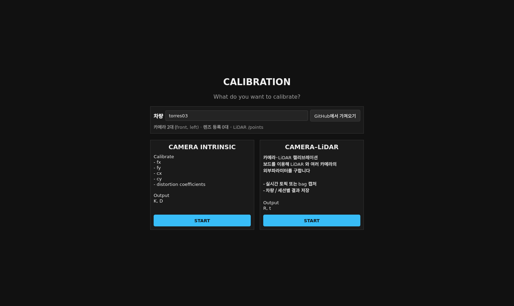
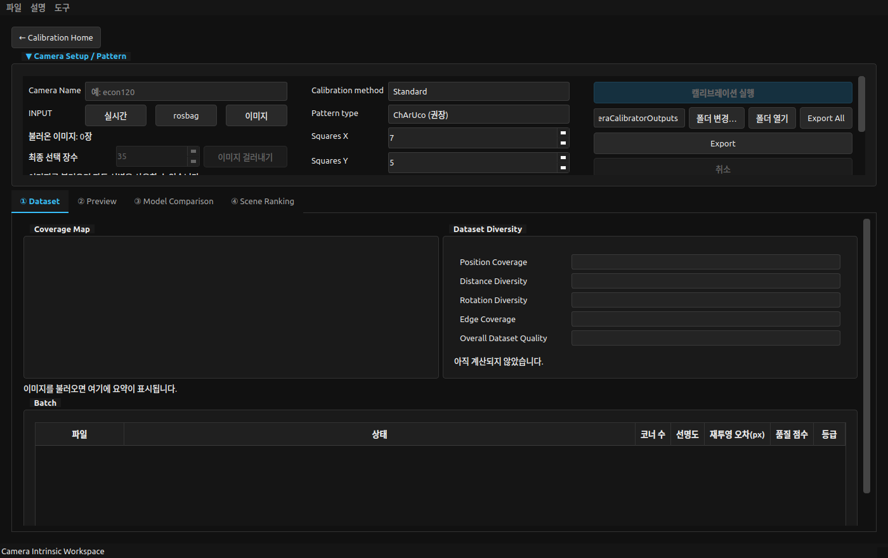
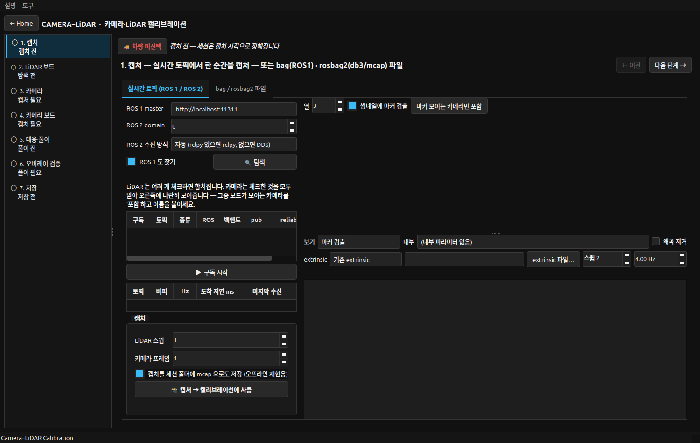

# Calibration Tool

카메라 **내부파라미터**(K, D)와 **카메라–LiDAR 외부파라미터**(R, t)를 한 프로그램에서 구합니다.



| 기능 | 넣는 것 | 나오는 것 |
|---|---|---|
| **CAMERA INTRINSIC** | 보드 사진 / rosbag / 실시간 ROS 토픽 | 카메라 1대의 K, D (모델 4종 비교·추천) |
| **CAMERA–LiDAR** | 보드 여러 장이 놓인 공간을 한 번 캡처 (실시간 또는 rosbag) | 여러 카메라의 LiDAR 기준 R, t |

ROS 를 설치하지 않아도 됩니다. bag 파일 읽기와 실시간 토픽 수신(ROS 1·ROS 2)이 모두 프로그램 안에서 됩니다.

---

## 1. 설치 (처음 한 번)

```bash
git clone -b calibration-tool https://github.com/yjssing/calibration.git
cd calibration
./install.sh
```

- Ubuntu 22.04 / 24.04 에서 아무것도 없는 상태부터 필요한 것을 모두 설치합니다. 중간에 `sudo` 비밀번호를 물을 수 있습니다.
- 모든 Python 패키지는 이 폴더의 `venv/` 안에만 설치됩니다. PC 의 다른 환경은 바꾸지 않습니다.
- sudo 권한이 없으면 `./install.sh --no-system`
- Windows: [Python 3.10+](https://www.python.org/downloads/) 설치 후 `install.bat`

## 2. 실행

```bash
./run.sh          # Windows: run.bat
```

흰 바탕 화면이 좋으면 메뉴 **보기 → 화면 테마 → 라이트** (다시 시작하면 적용, 다음부터 기억).

## 3. 사용법

### ① 차량 고르기 (홈 화면)

맨 위 **차량** 칸에서 고른 뒤 아래 START 를 누릅니다.

| 이럴 때 | 고르는 것 |
|---|---|
| 차량에 달린 카메라 | 차량 이름 (목록에서 고르거나 새 이름 입력) |
| 차량에 달지 않은 카메라 하나 | `차량 없음 (카메라 단품)` — CAMERA INTRINSIC 만 가능 |
| 다른 PC 에서 작업한 차량 | `GitHub에서 가져오기` |

두 기능이 같은 차량 정보를 씁니다. 카메라 이름과 렌즈가 자동으로 이어집니다.

### ② CAMERA INTRINSIC — 카메라 내부파라미터



1. **Camera Name** 을 고릅니다 (차량의 카메라 목록, 또는 새 이름).
2. **입력**: `이미지` / `rosbag` / `실시간` 중 하나로 보드 사진을 불러옵니다.
   거리·각도·화면 위치를 다양하게 바꿔 찍은 사진일수록 결과가 좋습니다.
3. **보드 설정**: 보드 종류, 칸 수, 칸 크기(mm). ChArUco 를 권장합니다.
4. **`캘리브레이션 실행`** → `Model Comparison` 탭에서 결과 확인.
   **Hold-out RMS** 가 낮고 Train RMS 와 비슷하면 믿을 수 있는 결과입니다.
5. **저장**: `Export` / `Export All`.
   Export 창의 **`CAMERA–LiDAR 렌즈로 등록`** 을 누르면 이 결과가 CAMERA–LiDAR 에서 자동으로 쓰입니다.

### ③ CAMERA–LiDAR — 카메라·LiDAR 외부파라미터



보드 여러 장이 놓인 공간을 **한 번 캡처**해서 모든 카메라를 한꺼번에 구합니다. 캡처하는 동안 차량과 보드는 움직이면 안 됩니다.

왼쪽 단계 목록을 위에서부터 차례로 진행합니다.

| 단계 | 할 일 |
|---|---|
| 1. 캡처 | **실시간**: `탐색` → LiDAR·카메라 토픽 체크 → `구독 시작` → `캡처`<br>**bag**: 파일을 열고 토픽 체크 → `불러오기` |
| 2. LiDAR 보드 | 보드가 있는 곳에 ROI 를 드래그로 그리고 찾기 (그리지 않으면 전체 탐색, 느림) |
| 3. 카메라 | `모든 카메라 자동 순위` — 카메라마다 렌즈를 골라 줍니다 |
| 4. 카메라 보드 | `모든 카메라 보드 검출` |
| 5. 풀이 | `모든 카메라 풀기`. 보드가 1~2개만 보이는 카메라가 `모호 — 방향 지정` 이면 표에서 **방향**(정면·좌·우·후…)을 고릅니다 |
| 6. 오버레이 | 점군이 이미지의 보드·물체와 겹치는지 눈으로 확인 |
| 7. 저장 | `저장` |

같은 차량을 다음에 다시 하면 토픽, 카메라 이름, 렌즈, 방향, ROI 를 그대로 불러옵니다.

## 4. 결과

| 기능 | 저장 위치 | 주요 파일 |
|---|---|---|
| CAMERA INTRINSIC | `~/CameraCalibratorOutputs/<세션>/` | `intrinsic/camera_<모델>.yaml`, `camera_info.yaml`, `reports/report.html` |
| CAMERA–LiDAR | `extrinsic/calib_result/<차량>/<캡처 시각>/<카메라>/` | `extrinsic.txt`, `result.yaml`, `report.html` |

**Git 에 올리기**: 저장 화면의 `⬆ Git 업로드` 버튼 (CAMERA INTRINSIC 은 Export All 아래, CAMERA–LiDAR 는 7단계).
처음 한 번 `⚙ Git 설정` 에서 결과 저장소 주소와 작성자를 넣으면 됩니다. 결과값 파일과 차량 정보만 올라갑니다.

## 5. 문제가 생기면

| 증상 | 해결 |
|---|---|
| `venv 가 없습니다` | `./install.sh` 를 먼저 실행 |
| Qt / 화면 관련 오류, 아이콘이 □ 로 보임 | `./install.sh` 를 다시 실행 |
| 실시간 탐색에 토픽이 안 보임 | 같은 네트워크인지, ROS 2 는 `ROS_DOMAIN_ID` 가 같은지 확인 |
| CAMERA–LiDAR 3D 뷰가 검게 나옴 | 그래픽 드라이버 확인 (원격 접속에서는 3D 뷰가 안 될 수 있음) |

더 많은 증상은 [docs/REFERENCE.md](docs/REFERENCE.md#문제-해결) 에 있습니다.

## 더 알아보기

| 문서 | 내용 |
|---|---|
| [docs/REFERENCE.md](docs/REFERENCE.md) | 설치 상세, 명령줄 실행(`./cli.sh`), 결과 폴더 구조, Git 업로드 규칙, 폴더 구조, 개발자용 |
| [docs/CAMERA_LIDAR.md](docs/CAMERA_LIDAR.md) | CAMERA–LiDAR 상세: ROI, 카메라 방향, LiDAR 기종별 주의 |
| [docs/INTRINSIC_EXPERT.md](docs/INTRINSIC_EXPERT.md) | 카메라 모델 수식, 검증 지표, 프로젝트 파일 |
| [docs/automation/](docs/automation/README.md) | 배치·실시간 자동 캘리브레이션 |
| [docs/JETSON.md](docs/JETSON.md) | Jetson 설치 |
