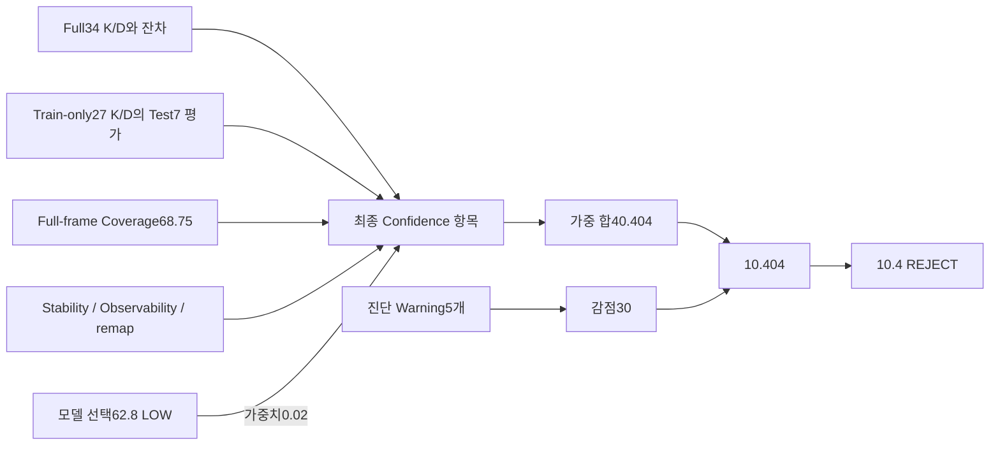

# Calibration Confidence10.4 상세 진단

2026-11-03. 신규 최적화 기능이나 계산 정책을 추가하지 않았다. 기존 P5 최종 Fisheye 결과의 Confidence를 정확히 재구성했고, 공통34장 Rational/Fisheye의 안정성·영역 오차를 비교했다. 기존 원본·결과·미커밋 변경을 보존했다. 차량 적용/자동 승인, Commit, Push, 배포는 수행하지 않았다.

## 결론

**10.4는 계산식 오류가 아니라 현재 정책과 측정값의 정확한 결과다.**

```text
10개 항목의 사용 점수 × 기존 가중치 합 = 40.404
진단 경고5개 ×6점, 최대30점          = −30.000
차감 후                             = 10.404
0~100 clamp                         = 10.404
WARN 등급 cap69                     = 비활성, 그대로10.404
소수1자리 반올림                     = 10.4 / REJECT
```

가장 큰 직접 감점은 warning5개의30점이다. 가중 손실로는 **Test P95(14점), Test RMS(13.914점), Full-fit RMS(10.304점), Observability(8점)**이 크다. Stability의 가중 손실은2.480점이지만 instability 진단 warning6점에도 연결된다. 같은 품질 신호가 component와 진단에 함께 반영되는 것은 기존 heuristic 정책이며 이번 작업에서 가중치·중복 감점 규칙을 변경하지 않았다.

**모델 선택 Confidence62.8/LOW, 최종 Calibration Confidence10.4/REJECT, overall grade WARN은 서로 다른 판정**이다. 10.4나62.8을 실제 정확도/안전 확률로 해석하지 않는다. 실제 독립 촬영 검증은 아직 없다.

표시 버그는 있었다. HTML이10.4를10,62.8을63으로 반올림하고, 모델 비교 행을 단순히“Confidence”, Full-fit 기여를“train_rms”로 표시했다. 실패하는 재현 테스트를 먼저 추가한 뒤 **표시만** 수정했다. 계산식·JSON 숫자·K/D·추천·판정은 유지했다.

## 1. 코드와 데이터 흐름

1.`app/cli.py::_validate_choose_and_export` → `calibration/recommender.py::compute_final_result`.
2.`compute_final_result`가 기존 RMS 등급 규칙으로 overall grade를 만들고 `diagnose_calibration`을 실행한다.
3.`compute_final_confidence`(recommender.py1046행)가 현재 성공한 Full-fit `CalibrationResult`, 별도 Train-only `ValidationResult`, **Full-frame Coverage**, ModelScore 및 진단 pattern을 소비한다.
4.`_score_lower_better`(1014행) 또는 identity0~100 점수로 변환하고, **각 component를 먼저 소수1자리로 반올림**한다.
5.측정된 component의 가중치 합으로 나누고, validation/coverage 누락 감점 및 진단 severity 감점을 차감한다.
6.0~100 clamp → overall grade cap → 최종 소수1자리 → `_final_confidence_level`로 분류한다.
7.project/JSON/HTML로 같은 최종 Confidence를 내보낸다. `model_scores[].selection_confidence`는 별도 값이다.



원본 결과 출처: `.verification/p5final/project/calibration.ccproj`.
Full-fit RMS1.5386657429px는 **실제34장/1255코너로 구한 Export K/D**와 그 최적화 자세의 잔차다. legacy component key인 `train_rms`는 **Full-fit RMS**를 뜻하며, 별도 validation Train RMS1.5164065248px가 아니다.
Hold-out1.6136043045px는 별도 **실제 Train27 K/D**를 고정한 Test7장303코너 평가다. nominal Train ID 목록은28장이지만 native fit에서 frame5를 제외한 실제27장이다. 최종 Export K/D에는 Test7도 full 학습으로 들어갔으므로 Hold-out 점수는 Export K/D의 독립 검증값이 아니다.

## 2. 원값·정규화·가중 기여

첫5개 잔차의 정규화는 `clamp(100×(poor−value)/(poor−excellent),0,100)`이다. excellent 이하100,poor 이상0이다. 나머지는 기존0~100 점수를 사용한다. 이 정책은 모델 추천의 후보 간 min-max 정규화와 별개다.

| component | 측정 원값 | excellent / poor | 변환 원점수 | 실제 사용 점수 | 가중치 | 가중 기여 |100점 대비 가중 손실|
|---|---:|---|---:|---:|---:|---:|---:|
| train_rms | 1.538665743 | 0.25 / 2.00 | 26.361958 | 26.4 | 0.14 | 3.696 | 10.304 |
| test_rms | 1.613604305 | 0.30 / 2.00 | 22.729159 | 22.7 | 0.18 | 4.086 | 13.914 |
| test_p95 | 3.582531881 | 0.60 / 3.00 | 0.000000 | 0.0 | 0.14 | 0.000 | 14.000 |
| edge_rms | 1.413607202 | 0.40 / 2.50 | 51.732990 | 51.7 | 0.12 | 6.204 | 5.796 |
| straightness | 0.400328793 | 0.20 / 1.50 | 84.590093 | 84.6 | 0.08 | 6.768 | 1.232 |
| coverage | 68.750000000 | identity | 68.750000 | 68.8 | 0.10 | 6.880 | 3.120 |
| stability | 68.956186053 | identity | 68.956186 | 69.0 | 0.08 | 5.520 | 2.480 |
| observability | 0.000000000 | identity | 0.000000 | 0.0 | 0.08 | 0.000 | 8.000 |
| undistortion | 99.859133873 | identity | 99.859134 | 99.9 | 0.06 | 5.994 | 0.006 |
| model_selection | 62.800000000 | identity | 62.800000 | 62.8 | 0.02 | 1.256 | 0.744 |

첫5개 원값의 단위는px, 나머지는0~100 또는%다. **총 가중치1.00**, 기여 합40.404,100점 대비 손실59.596이다. 이번 결과에는10개 항목 모두 존재하므로 누락 항목 재정규화가 일어나지 않았다. JSON/CSV에는 반올림 전 점수와 정확한 출처까지 저장했다: `confidence-breakdown.json`, `confidence-breakdown.csv`.

추가 감점:

| 조건 | 현재 상태 | 감점 |
|---|---|---:|
| Hold-out 없음/실패 |성공, Test7 모두 pose 평가 성공|0|
| Coverage 미측정 |Full-frame68.75가 존재|0|
| Diagnosis ERROR |0개|0|
| Diagnosis WARNING |5개|30|
| INFO |Observability 설명 등|0|
| WARN 등급 상한69 |현재10.404<69|0|

최종 Confidence가50미만이므로 REJECT다. overall grade WARN은 Full/Test/Edge RMS가 기존1≤값<2px 구간에 있어 결정된다. 두 판정이 다르게 나오는 것은 서로 다른 계산 규칙 때문이며 저장/출력의 모순이 아니다.

## 3. 경고30점의 근거

| 코드 | severity | 실제 근거 | 연결 지표/조치 |
|---|---|---|---|
|limited_coverage|WARNING|Full-frame68.75%<기존75%|보닛 포함 전체 화면 기준|
|coverage_location_gaps|WARNING|하단/하단 모서리0관측|구조적 occlusion. 추가 촬영 불가능 영역은 안내에서 제외|
|edge_residual_high|WARNING|Test Edge1.413607px, Full-fit1.538666px|가시 영역 잔차 확인|
|unstable_parameters|WARNING|전체 stability68.956%, fx/fy std28.812/26.286px|고차D와 초점거리 bootstrap|
|high_parameter_correlation|WARNING|max correlation0.992196, k3/k4|파라미터 결합/식별가능성|

각 warning6점,합계30점이며 cap30과 정확히 같다. Full-frame coverage 두 경고와 component coverage는 겹치는 근거를 가진다. 마찬가지로 높은 상관은 Observability component 및 별도 warning에 반영된다. **수치 처리 버그로 단정할 근거는 없으며 정책상 중첩**이다. 실제 정확도의 통계적 확률을 산출하는 공식도 아니다.

Mask 기반 Observable Coverage77.028112%는 P2 Readiness/촬영 가이드에 사용되지만, 최종 Confidence의 coverage 원값은 **기존 Full-frame68.75%**다. 보닛은 구조적으로 가려져 있으므로 이 감점을 추가 촬영으로 해결할 수 있다고 안내해서는 안 된다. 이전 수정대로 가이드는 보닛 위 가시 영역만 대상으로 하며, 이번에는 점수 입력이나75% 기준을 바꾸지 않았다.

## 4. 가장 큰 잔차 원인과 프레임

원래 Fisheye Train-only K/D로 Test7의 자세·코너 잔차를 다시 계산하여 저장된 Test RMS/P95를 재현했다. 모든 Test 프레임을 유지했고 재학습·코너 삭제·Test 기반 seed 선택은 하지 않았다.

| Test 프레임 |코너|RMS px|프레임 P95 px|최대 px|3px 초과 코너|Test point SSE 비중|
|---|---:|---:|---:|---:|---:|---:|
| `capture_000011_7d19387bf7f8495dbbc1a16af934fdd0` | 54 | 2.987425 | 4.396467 | 5.284242 | 21 | 54.87% |
| `capture_000014_7fae8d07c3724cf98ee73125c3054f50` | 54 | 1.617067 | 2.913652 | 4.801007 | 3 | 16.08% |
| `capture_000020_03886957beca4e958e43de490873577f` | 45 | 1.320739 | 2.122280 | 2.935404 | 0 | 8.94% |
| `capture_000034_e285cc4869fc4dfda1daa29fee190fdd` | 30 | 1.536194 | 2.401967 | 2.857264 | 0 | 8.06% |
| `capture_000018_bf5230879994416082e3ff4db89fd1d3` | 45 | 1.023690 | 1.851724 | 2.294308 | 0 | 5.37% |
| `capture_000024_e0634be7efba4e63aaecb59587444b7d` | 45 | 0.919021 | 1.589977 | 2.537914 | 0 | 4.33% |
| `capture_000025_5f8f50ae40494ebf81059137dae2cf89` | 30 | 0.830441 | 1.542559 | 2.209445 | 0 | 2.36% |

`capture_000011_7d19387bf7f8495dbbc1a16af934fdd0`의54코너 중21개가3px를 넘는다. 전체 Test303코너에서3px 초과24개 중21개이며, point SSE의**54.87%**다. 다음 frame14가약16.1%를 차지한다. Test P95=3.582532px가 기존 poor3.0px를 넘어 component가0점이 되는 데 중요한 근거다.

Frame11은 전체 ChArUco54코너 검출 성공이며 quality overall64.1/GOOD, blur72.4, exposure62.8, corner100이었다. 따라서 단순 검출 실패나“흐린 이미지 한 장”이라고 확정할 수 없다. 높은 잔차는 주로 보드 둘레 코너에 보이며 Rational과 Fisheye에서 같은 프레임이 가장 높다. 보드 평탄도/인쇄·치수, 검출 편향, 촬영/광학계 또는 모델 근사의 영향은 **가능성**이며 원인 확정은 아니다. 시각화 `worst-test-frame.png`, 모든 corner ID·좌표·dx/dy·오차는 `corner-errors.csv`에 보존했다.

Test를 삭제하면 점수가 달라질 수 있지만 그것은 독립 성능 개선이 아니다. 이번에는 해당 프레임을 그대로 두고 동일 자세·거리 조건의 **새 촬영**으로 원인을 확인하는 계획만 제안한다.

## 5. Observability·Stability·실패 이력의 반영

### Observability

Fisheye는 Rank8/8, normalized condition1436.474,2510 Jacobian rows/1255코너다. 미측정 또는 rank deficiency가 아니다. 현재 score 함수에서 condition≤1e4는 감점0, rank full도 감점0이지만, 상관0.992196은 기존 `(corr−0.8)/0.19` 항을100으로 clamp하여 **Score0/POOR**를 만든다. 별도 high-correlation warning은 기존0.98 기준으로 발생한다. 숫자0은 측정 실패가 아니라 **강한 계수 결합을 반영한 낮은 점수**다.

이 Jacobian은 고정 자세의 local intrinsic 평가이며 Extrinsic coupling이 주변화된 전체 식별가능성은 아니다. Score0이 계산 불가능이나 K/D가 반드시 오답임을 뜻하지 않는다. 새 거리·yaw/pitch·가시 경계 관측과 독립 검증이 필요하다. 임계값을 완화하거나 제거하지 않았다.

### Stability

`_parameter_stability_score`는 bootstrap 결과가 있으면 이를 우선하고, overall stability·fx/fy/cx/cy·각D stability를 기존 방식으로 평균한다. 이번 Fisheye에서는 모든 항목이 있어 overall68.956186과 같은 결과가 된다. normalized component는69.0이다.

Fisheye bootstrap20/20 성공. K 전용 평균 안정성은99.0445지만 D 평균은38.8678이며 k2/k3/k4는27.48/25.13/25.16이다. fx/fy std는28.812/26.286px(기준 대비약1.49%/1.35%)다. **K가 비교적 안정적이어도 고차D는 강하게 결합·변동할 수 있다.** bootstrap 성공20회는 높은 정확도·전역 수렴 보증이 아니다.

### 실패/제외 이력

- 과거 Pinhole seed 기반 Fisheye 실패: 현재 Confidence의 직접 입력 아님.
- Full35에서 frame5의 `input array5` 조건수 실패: 성공한34장 fit으로 복구됐다. 실패 횟수·제외 장수에 대한 별도 감점 없음.
- 제외의 영향: 관측 프레임·잔차·Stability·Observability를 통해 **간접 반영**될 수 있다. 실제 동일값을 유지하고 warning/audit의 과거 실패·제외 이력만 바꾸면 점수는 그대로임을 테스트했다.
- 현재 cal.success=False라면 즉시0/REJECT. 현재는 SUCCESS이며 Test pose 실패도0건이다.
- 미확인 Marker75mm·새 독립 촬영 부재는 현재 Confidence의 독립적인 입력 항목이 아니다. 따라서 결과 해석에서 별도 미검증 상태를 명시해야 한다.

## 6. 공통34장 Rational/Fisheye의 안정성 비교

기존 공정 비교 Full34/1255코너,Train27/Test7를 유지했다. Rational은 기존 cold 결과를 사용한다. Fair 비교를 위해 Rational에도 **기존 `compute_parameter_bootstrap`**,20회/seed42/같은34개 프레임 복원추출을 적용했다. Fisheye20회 결과는 동일 프레임/seed/절차의 기존 P5 결과를 재사용했고 중복 실행하지 않았다.

| 항목 |Rational|Fisheye|
|---|---:|---:|
|bootstrap 성공/시도|20/20|20/20(재사용)|
|전체 파라미터 Stability|35.3338|68.9562|
|K 전용 평균 Stability|98.8923|99.0445|
|D 전용 평균 Stability|3.5546|38.8678|
|fx std px|27.3564|28.8121|
|fy std px|24.6428|26.2861|
|cx std px|12.8409|8.2844|
|cy std px|11.9116|6.0658|

두 모델의 K 안정성은 비슷하지만 Rational의 분자/분모D는 더 불안정했다. p1/p2처럼0에 가까운 계수의 상대 변동 점수도 낮아질 수 있어 raw std/CI/near-zero flag를 함께 기록했다. 모델별D의 수학적 의미·개수가 다르므로 개별 계수의 숫자를 직접 대조하지 않는다.

동일 seed로 동일한 frame indices를 사용했으나 native 모델 함수/필수 flags는 각 모델의 기존 정의다. bootstrap은 기존 코드대로 reference K/D를 seed로 쓰고 native 기본 종료조건을 사용한다. 따라서 이는 **reference 부근의 국소 재표본 안정성**이며 독립/전역 초기화 안정성 검증이 아니다. 이번 측정은 진단용이며 원래 Rational/Fisheye 결과나 추천에 입력하지 않았다. 특히 Rational의 새35.3338을 원래 Fisheye10.4 계산에 섞지 않았다.

## 7. 같은 코너 위치의 영역별 오차

| 영역 |Full/Test 관측 수|Rational Full RMS|Fisheye Full RMS|Rational Test RMS|Fisheye Test RMS|
|---|---:|---:|---:|---:|---:|
| center | 102 / 33 | 2.257504 | 2.264683 | 2.031168 | 2.292864 |
| left | 511 / 112 | 1.524075 | 1.538291 | 1.153456 | 1.165479 |
| right | 436 / 130 | 1.199167 | 1.202487 | 1.869011 | 1.728061 |
| top | 818 / 207 | 1.383750 | 1.377604 | 1.538966 | 1.484412 |
| bottom | 0 / 0 | 미측정 | 미측정 | 미측정 | 미측정 |
| corner | 612 / 179 | 1.246663 | 1.241949 | 1.402171 | 1.276479 |

Full은 각 모델의 Full34 K/D와 최적화 자세, Test는 별도 Train27 K/D와 고정Test7 pose 추정이다. 같은 corner ID/위치/프레임·정의를 사용했다. 영역들은 중첩되므로 관측 수를 합하면 전체 코너 수가 되지 않는다.

Test 중앙은 Rational이 낮고 우측/상단/모서리는 Fisheye가 낮다. 기존 edge 지표는 측정된 left/right/top/bottom/corner **각 영역 RMS의 평균**이다. 하단이 없으면0을 넣지 않고 제외하므로 Fisheye1.413608px, Rational1.490901px다. 전체 외곽 포인트를 한 번에 pooled RMS로 계산한 값과는 다르다.

하단은 양쪽 모두 관측0 → **None/미측정**이다. 보닛 Mask 적용 영역의 정확도가 좋거나 나쁘다고 판정할 근거가 없으며, “오차0”도 아니다.

## 8. 미측정과 실패 상태 구분

| 대상 |현재 상태 | Confidence 처리/해석 |
|---|---|---|
|현재 Full-fit|성공, RMS 측정|component에 반영|
|현재 Hold-out|성공,7장303코너, pose 실패0|Test/edge/straightness 반영|
|Test P95|측정됨, 기준보다 높음|0점. 계산 실패 아님|
|Observability|측정됨, full rank, 높은 상관|0점. 미측정 아님|
|Stability|측정됨, bootstrap20/20|69.0점. 낮은 D 안정성|
|하단 regional error|관측0/미측정|None, edge 평균에서 제외|
|과거 Fisheye 시도|실패 후 복구|현재점수에 이력 자체 직접 감점 없음|
|frame5|성공 fit에서 제외, 원본 보존|전체 불량/오검출 확정 아님|
|독립 새 촬영|미실시|현재 공식에 별도 항목 없음; 정확도 미검증|
|Marker75mm|미확인 가정|현재 공식에 별도 항목 없음; 실측 필요|

기존 함수는 None 지표를0점으로 바꾸지 않고 component에서 제외하여 남은 가중치로 재정규화한다. 단, Hold-out 없음/실패는 별도−10, Coverage 없음은−5다. 이 함수의 경고 문구는 Hold-out 없음/실패를 함께 표기하지만 원본 ValidationResult의 success/error와 이번 상태표에서는 두 경우를 구분한다. 이번 실제10.4에는 누락 component나 이 누락 감점이 없다.

## 9. 최소 수정과 검증

수치 계산 버그는 발견되지 않았다. `export/report.py`만 수정했다:

- 두 Final Confidence 표시의 소수1자리 보존(10.4).
- Model selection Confidence 행의 이름·소수1자리 보존(62.8).
- legacy component `train_rms`의 화면 이름을“Full-fit RMS score (export K/D)”로 명확화. JSON 키/계산 의미는 그대로다.

재현 테스트 `tests/test_confidence_report_labels.py`는 수정 전에 실패했고 수정 후 통과했다. `test_confidence_recipe.py`는 정확한10.4, 과거 실패/제외의 직접 감점 부재, 현재 실패 시0, 미측정0점과 측정0점 구분, Hold-out 없음/실패 처리의 기존 동작을 검증한다.

이번 범위 고유 테스트 **29 PASS /0 FAIL /0 SKIP /0 XFAIL**. source hash 비교로 numerical core/알고리즘/등급/추천 가중치 변경이 없고, 기존125개 이미지의 hash도 동일함을 확인했다. 이전319개 전체 회귀를 이번에 다시 실행한 것은 아니다. 표시만 변경했으므로 HTML/JSON/Export 및 관련 집중 회귀를 실행했다.

`export/` 디렉터리에 원본 project를 재사용해 새 HTML/JSON/project를 생성했다. **재검출·캘리브레이션 재학습 없음**, 모든 모델의 K/D·추천·최종Confidence가 동일했다. 기존 결과 파일은 덮어쓰지 않았다. Bootstrap Rational20회는 별도 통계 측정만 수행했고 각 sample indices/시간/native RMS/성공·실패 로그를 남겼다.

## 10. 실제 품질 문제와 추가 검증 과제

- **실제 관측된 품질 문제:** 약1.5px 수준 잔차, frame11의 Test 꼬리 오차, 중앙/가시 외곽의 잔차, 고차D 강한 상관과 bootstrap 변동. 기준을 바꾸지 않는 이상 낮은 Confidence의 근거다.
- **정책/측정 범위의 제한:** 구조적 보닛에 대한 Full-frame Coverage 감점, 여러 지표와 warning의 중첩, 고정-pose Jacobian, reference-seeded bootstrap, 상대 모델 선택 점수. 계산 버그로 단정하지 않고 정책적 한계로 기록했다.
- **추가 검증으로 확인할 사항:** 실측 Square100mm/Marker75mm/보드 평탄도, frame11과 유사한 보드 위치·거리·tilt의 새 반복 촬영, 가시 영역의 선명한 코너와 yaw/pitch·거리의 독립 변화, 고정 Export K/D의 새 녹화 평가.
- 기존 Test를 제거하거나 학습·초기값·하이퍼파라미터 선택에 사용하지 않는다. 개발/Validation에서 전략을 고정하고 **새 독립 Test**에서 평가해야 한다. 기존 `docs/P5_INDEPENDENT_VALIDATION.md`의 경로를 사용한다.

독립 촬영 검증 전까지 결과는 진단용/미승인이며 차량 적용·자동 승인 대상으로 취급하지 않는다. Marker75mm는 **UNCONFIRMED_ASSUMPTION**이다. 실제 ROS/카메라 하드웨어 및 독립 실데이터 정확도는 이번에 검증하지 않았다.

## 증거 파일

`.verification/confidence-audit/`의 `confidence-breakdown.json/.csv`, `residual-audit.json`, `corner-errors.csv`, `worst-test-frame.png`, `rational-bootstrap.json`, `rational-bootstrap-samples.jsonl`, `fisheye-bootstrap-reused.json`, JUnit·test-ledger 및 `CONFIDENCE_DIAGNOSIS_MANIFEST.json`.

표시 수정 외 기존 source 변경을 보존했다. 새 문서는 본 보고서, 새 테스트는 위2파일이다. 재현/진단 스크립트는 증거 디렉터리에 보관했다.
