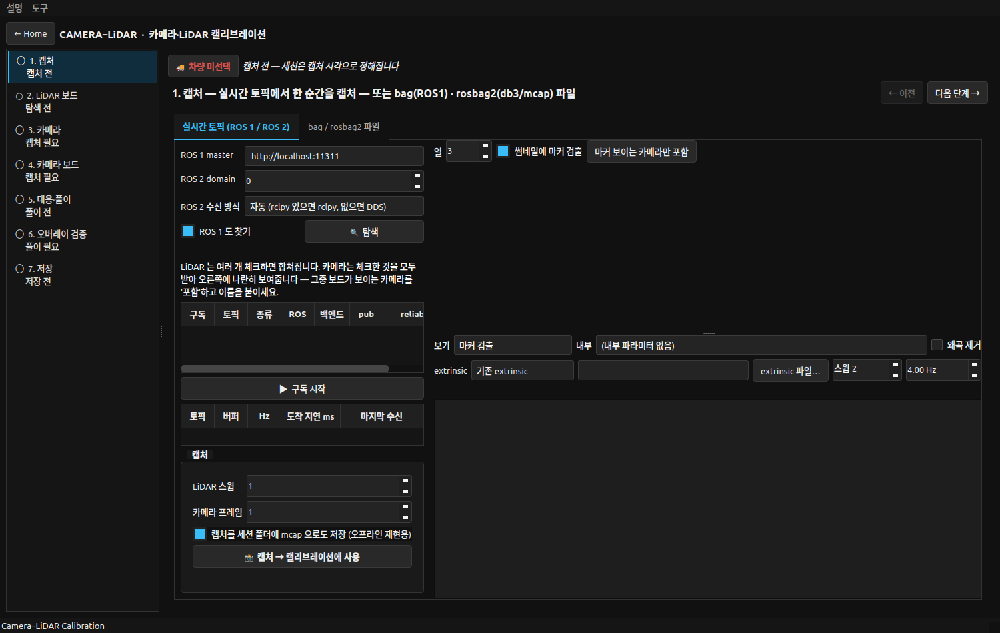

# 참고 자료 (상세)

README 의 간단한 사용법 뒤에 있는 자세한 내용입니다.

## 설치

**Linux (Ubuntu 22.04 / 24.04)**: 아무것도 설치되지 않은 PC에서도 아래 한 줄이면 됩니다.

```bash
./install.sh
```

스크립트가 하는 일 (여러 번 실행해도 안전합니다. 이미 있는 것은 건너뜁니다):

1. 빠진 시스템 패키지만 `apt`로 설치합니다. `sudo` 비밀번호를 물을 수 있습니다.
   - `python3`, `python3.X-venv`
   - Qt 화면 표시·OpenGL 라이브러리 (`libxcb-cursor0` 등)
   - 한글·이모지 폰트
2. 이 폴더 안에 `venv/`를 만듭니다. pip 없이 반쯤 만들어진 venv나 다른 PC에서 복사된 venv가 있으면 지우고 새로 만듭니다.
3. `requirements.txt`를 설치합니다.
4. `cyclonedds`를 설치합니다. 휠이 없는 플랫폼(aarch64 등)에서는 CycloneDDS C 라이브러리를 `venv/opt/cyclonedds`에 소스 빌드합니다. 빌드에 실패해도 경고만 띄우고 계속합니다.
5. import와 Qt 플랫폼 플러그인 의존성을 확인합니다.

| 옵션 | 설명 |
|---|---|
| `./install.sh --dev` | 테스트 도구(pytest)까지 설치 |
| `./install.sh --no-system` | sudo 권한이 없을 때. apt 단계를 건너뛰고 venv와 Python 패키지만 설치 |

**Windows**: [Python 3.10+](https://www.python.org/downloads/)를 설치한 뒤 `install.bat`를 실행하세요.

ROS를 설치하지 않아도 됩니다. bag 파일(`.bag` / `.db3` / `.mcap`)은 `rosbags` 라이브러리로 직접 읽습니다.
실시간 캡처(두 기능 모두)도 ROS 설치 없이 동작합니다. ROS 1은 마스터에 직접 접속하고, ROS 2는 `cyclonedds`로 받으며, ROS 2가 source되어 있으면 `rclpy`를 사용합니다.

## 명령줄 실행 (GUI 없이)


```bash
./cli.sh intrinsic    --help    # 카메라 내부파라미터 (이미지 폴더 / bag)
./cli.sh camera-lidar --help    # 카메라·LiDAR 외부파라미터 (bag)
./cli.sh automation   --help    # 자동화: run / check / live / factory
```

## Camera–LiDAR 단계별 설명



보드 여러 장이 놓인 공간을 **한 번 캡처**해서 LiDAR와 **여러 카메라**의 extrinsic을 한꺼번에 구합니다.
캡처하는 동안 차량과 보드가 모두 정지해 있어야 합니다.

**홈 화면에서 고른 차량으로 열립니다** (차량은 홈 화면에서만 고르고 바꿉니다). 결과는 차량 / 캡처 시각(세션) / 카메라별 폴더로 저장됩니다.
같은 차량을 다시 고르면 지난번 LiDAR 토픽, 카메라 이름, 내부파라미터 프리셋, ROI를 그대로 불러옵니다.
지난 결과는 카메라 이름으로 짝지어 **기존 extrinsic**으로 표시하므로, 새 결과와 비교할 수 있습니다.

| 단계 | 하는 일 |
|---|---|
| 1. 캡처 | **실시간 탭**: `탐색` → LiDAR·카메라 토픽 체크 → `구독 시작`. 카메라 썸네일에 마커 검출 수가 표시되므로, 보드가 보이는 카메라를 `포함`하고 이름(`FRONT_LEFT` 등)을 붙인 뒤 `캡처`합니다. 기본값은 LiDAR 1스윕과 카메라마다 1장입니다. 캡처 원본은 세션 폴더에 mcap으로 저장되어 나중에 다시 계산할 수 있습니다.<br>**bag 탭**: bag(ROS1) 또는 rosbag2(db3/mcap)를 엽니다 |
| 2. LiDAR 보드 | 위에서 본 화면(BEV)에 ROI를 드래그로 그리면 그 안에서만 보드를 찾습니다. 전체를 탐색하는 것보다 10배 이상 빠릅니다. 찾은 보드는 모든 카메라가 함께 씁니다 |
| 3. 카메라 | `모든 카메라 자동 순위`를 누르면 카메라마다 내부파라미터 프리셋을 보드 재투영 오차로 골라 줍니다. `파일에서 렌즈 불러오기…`로 Intrinsic 결과 YAML(또는 OpenCV YAML·ROS camera_info·Kalibr)을 바로 쓸 수 있습니다 |
| 4. 카메라 보드 | `모든 카메라 보드 검출` |
| 5. 대응·풀이 | `모든 카메라 풀기`를 누르면 위 표에 카메라별 요약, 아래 표에 선택한 카메라의 보드별 수치가 나옵니다. 보드가 많이 보이는 카메라부터 풀고, 보드 3쌍 미만이면 `확인 필요`, 보드 1~2개라 어느 보드인지 모르면 `모호 — 방향 지정`으로 표시합니다. 표의 **방향**(정면·좌·우·후 …)을 고르면 그 카메라를 바로 다시 풉니다 ([자세히](CAMERA_LIDAR.md#카메라-방향--보드가-12개만-보이는-카메라)) |
| 6. 오버레이 검증 | 상단 `카메라` 선택으로 카메라를 바꿔 가며 투영 결과를 확인합니다 |
| 7. 저장 | 체크한 카메라를 모두 세션 폴더에 저장하고, 차량 프로필을 갱신합니다 |

3~6단계는 카메라마다 하는 단계라 창 위쪽에 **카메라 선택** 칸이 나옵니다.

**프리셋 파일** (직접 편집하거나 GUI에서 저장)

- 카메라 내부파라미터: `extrinsic/gui/config/camera_intrinsics.yaml`
- 보드 규격: `extrinsic/gui/config/target_specs.yaml`

**Intrinsic 결과를 Camera–LiDAR에서 쓰려면** 둘 중 하나를 쓰면 됩니다.
- Intrinsic: `Export` 창의 `CAMERA–LiDAR 렌즈로 등록`
- Camera–LiDAR 3단계: `파일에서 렌즈 불러오기…`

둘 다 `camera_intrinsics.yaml`에 같은 형식으로 저장합니다(모델·fx·fy·cx·cy·k1~k6·p1·p2).

ROI 사용법, LiDAR 기종별 주의사항(벨로다인 보드 배치), 네트워크 설정은 [docs/CAMERA_LIDAR.md](CAMERA_LIDAR.md)에 있습니다.

**GUI 없이 실행 (배치)**

```bash
./cli.sh camera-lidar <bag|rosbag2 폴더> --vehicle <차량> --lidar /lidar/points \
    --cameras /cam/a=FRONT_LEFT,/cam/b=cam4:좌 [--roi x0,x1,y0,y1,z0,z1[,yaw]] [--sweeps 1]
```

---

## 결과 저장 위치

| 기능 | 위치 |
|---|---|
| Intrinsic | `~/CameraCalibratorOutputs/<YYYY-MM-DD_HHMMSS[_camera]>/` (GUI의 `폴더 변경…`으로 바꿀 수 있음) |
| Intrinsic 자동 복구본 | `~/.camera_calibrator/autosave.ccproj` (비정상 종료 뒤 다시 켜면 복구할지 묻습니다) |
| Camera–LiDAR | `extrinsic/calib_result/<차량>/<캡처 시각>/<카메라>/` |

```text
~/CameraCalibratorOutputs/<session>/          extrinsic/calib_result/<차량>/
├── manifest.json                             ├── vehicle.yaml          차량 프로필 (토픽, 카메라 이름·프리셋, ROI)
├── project/calibration.ccproj                └── 2026-11-18_143205/    세션 = 캡처 1회
├── intrinsic/camera_<model>.yaml                 ├── session.yaml      카메라별 결과 요약, 메모
├── intrinsic/camera_info.yaml                    ├── capture/          캡처 원본 (mcap, 재현용)
├── intrinsic/kalibr/                             └── FRONT_LEFT/       카메라마다
└── reports/ (report.html, calibration.json,          ├── extrinsic.txt (FAST-LIVO2 형식)
             dataset.csv)                              ├── result.yaml   (R, t, 보드별 수치)
                                                       ├── boards.yaml, overlay.png, report.txt / report.html
```

## 결과를 Git 에 올리기

계산이 끝난 결과를 **결과 전용 Git 저장소**에 올리는 버튼이 있습니다. 자동으로 올리지는 않고, 버튼을 눌러 파일 목록을 확인한 뒤 올립니다.

| 기능 | 버튼 위치 | 올라가는 것 | 저장소 안 경로 |
|---|---|---|---|
| Camera Intrinsic | 오른쪽 위 `Git 업로드` (Export All 옆) | 결과 YAML 만: `camera_<model>.yaml`, `camera_info.yaml` | `intrinsic/<차량>/<카메라 이름>/<세션>/` (차량 없음은 `no_vehicle`) |
| Camera–LiDAR | 7단계 `⬆ Git 업로드` (저장한 뒤 켜짐) | 저장한 카메라의 `extrinsic.txt`, `result.yaml` 만 | `extrinsic/<차량>/<세션>/<카메라>/` |

결과값 파일만 올립니다. 리포트, 오버레이 이미지, 프로젝트 파일, 원본 캡처는 로컬 결과 폴더에만 남습니다.
차량을 골랐으면 **차량 정보**도 같이 올라갑니다: `vehicles/<차량>/vehicle.yaml`(카메라 이름·토픽·렌즈 지정)과
`vehicles/<차량>/lenses.yaml`(그 차량 카메라들이 쓰는 렌즈 값). 다른 PC 는 홈 화면 `GitHub에서 가져오기`로 받습니다.
`⚙ Git 설정`에서 끌 수 있습니다.

- 처음 한 번 저장소 주소, 브랜치(기본 `main`), 작성자 이름·이메일을 입력하면 `~/.config/calibration-tool/git_upload.json` 에 기억합니다.
- 인증은 이 PC 의 git 설정을 그대로 씁니다. SSH 주소와 등록된 ssh 키, 또는 HTTPS 주소와 credential helper(`gh auth login` 등)가 필요합니다. 터미널에서 `git ls-remote <주소>` 가 비밀번호 없이 되면 됩니다.
- 브랜치가 저장소에 없으면 결과 파일만 있는 새 브랜치로 만듭니다(코드 파일이 섞이지 않음). 다른 사람이 먼저 올렸으면 합친 뒤 다시 올리고, 같은 결과를 또 올리면 커밋을 만들지 않습니다.
- Camera–LiDAR 에서 5단계 "확인 필요"(보드 3개 미만, 대응 모호) 카메라가 저장돼 있으면 올리기 전에 한 번 더 묻습니다.

## 폴더 구조

```text
calibration_ws/
├── install.sh / install.bat     설치 (venv/ 생성)
├── run.sh / run.bat             실행 (GUI)
├── cli.sh / cli.bat             실행 (명령줄: intrinsic / camera-lidar / automation)
├── run_tests.sh                 테스트
├── requirements.txt             의존성 (두 기능 공통)
├── docs/                        상세 문서
├── intrinsic/                   메인 앱 + 내부파라미터
│   ├── app/                     진입점 (GUI: app/main.py, CLI: app/tool.py → app/cli.py · room_calib · automation)
│   ├── shared/                  두 기능 공용: ROS 입출력(bag·디코딩·실시간 ROS 1/2/DDS), 카메라 모델 연산·렌즈 프리셋,
│   │                            ArUco 설정, Qt 백그라운드 작업, HTML 리포트 틀, 이름 규칙
│   ├── ui/                      화면 (홈, Intrinsic 작업공간, Camera–LiDAR 삽입 래퍼: ui/room_workspace.py)
│   ├── calibration/             검출·모델·검증·추천 로직
│   ├── export/                  OpenCV / ROS / Kalibr / 리포트 저장
│   ├── automation/              배치·실시간 자동 캘리브레이션 (CLI)
│   ├── scripts/                 Jetson 설치 스크립트 등
│   └── tests/
└── extrinsic/                   카메라·LiDAR 룸
    ├── gui/core/                보드 검출, 대응, extrinsic 풀이
    ├── gui/core/live.py         실시간 캡처 스냅샷·mcap 기록 (수신은 shared/ros/live.py)
    ├── gui/core/session.py      차량 프로필, 세션 폴더
    ├── gui/ui/room/             7단계 화면
    ├── gui/config/              카메라·보드 프리셋
    ├── gui/room_calib.py        룸 배치 실행 (CLI, ./cli.sh camera-lidar)
    └── calib_result/            룸 결과 (차량 / 세션 / 카메라)
```

## 문제 해결

| 증상 | 해결 |
|---|---|
| `./run.sh`: venv 가 없습니다 | `./install.sh`를 먼저 실행하세요 |
| PySide6 / Qt platform plugin 오류 (Linux) | `./install.sh`를 다시 실행하세요 (빠진 Qt 라이브러리를 apt로 설치). `--no-system`으로 설치했다면 `sudo apt install libegl1 libgl1 libxcb-cursor0 libxkbcommon-x11-0` |
| 버튼 아이콘이 □로 보임 | 이모지 폰트 누락: `sudo apt install fonts-noto-color-emoji` |
| ChArUco·AprilGrid 검출 시 `cv2.aruco` 오류 | 다른 `opencv-*` 패키지가 함께 설치된 경우입니다. `venv/bin/pip uninstall opencv-python opencv-contrib-python`로 지운 뒤 `./install.sh`를 다시 실행하세요 |
| Camera–LiDAR 화면에 "불러오지 못했습니다" 표시 | 의존성 누락입니다. `./install.sh`를 다시 실행하세요. 표시된 오류 메시지에 빠진 모듈 이름이 나옵니다 |
| Camera–LiDAR 실시간 탐색에 토픽이 안 보이거나 LiDAR 스윕이 빠짐 (다른 PC의 ROS 2) | 같은 네트워크·`ROS_DOMAIN_ID`인지 확인하세요. 큰 포인트클라우드는 `sudo sysctl -w net.core.rmem_max=8388608`이 필요합니다 |
| Camera–LiDAR 3D 뷰가 검게 나옴 | OpenGL 드라이버를 확인하세요. 원격 접속(ssh -X 등)이나 가상 디스플레이에서는 3D 뷰가 동작하지 않을 수 있습니다 |
| 테스트가 수집 단계에서 `lark` 오류로 멈춤 | ROS 환경이 source된 셸에서 생기는 문제입니다. `./run_tests.sh`를 쓰면 피할 수 있습니다 |

## 개발자용

```bash
./install.sh --dev
./run_tests.sh            # 빠른 테스트
./run_tests.sh --all      # 느린 통합 테스트까지
```

- [docs/CAMERA_LIDAR.md](CAMERA_LIDAR.md): Camera–LiDAR 상세 (ROI, LiDAR 기종별 주의, 실시간 캡처 경고 기준)
- [docs/INTRINSIC_EXPERT.md](INTRINSIC_EXPERT.md): 카메라 모델 수식, 검증 지표 정의, 프로젝트 파일 구조, CLI 사용법
- [docs/automation/](automation/README.md): 배치 / 실시간 자동 캘리브레이션, 결과 게시, 제조사 값 비교
- [docs/JETSON.md](JETSON.md): Jetson AGX Orin 설치 (내부파라미터 기능 기준)
